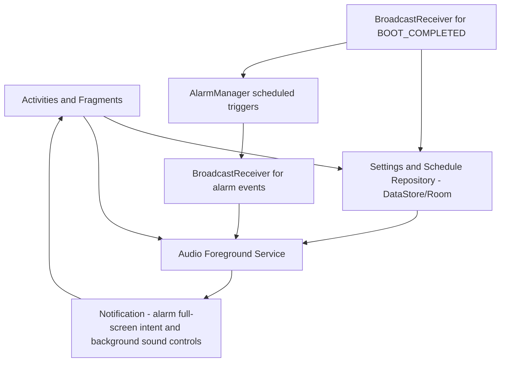

# On Time — Sound Machine & Alarm Clock Android App

**On Time** is a robust, reboot-resilient Android sound machine and alarm clock application. It is designed to play looping background sounds (e.g., white noise, water tracks) and schedule precise alarm events. The app is built with a focus on reliability, smooth audio transitions, and complete persistence across device reboots and application upgrades.

---

## Key Features

- **Background Sound Machine**:
  - Play and loop background audio tracks (e.g., white noise, rain, water).
  - Set custom play durations (HH:MM) or play indefinitely until stopped.
  - Smooth fade-out transitions when stopping or when a timed session ends.
- **Schedulable Events**:
  - Schedule any quantity of events (start alarm or stop background sound).
  - Select specific days of the week with a custom day-of-week selector.
  - "Daily" toggle: sets all days on unset-to-set, and clears all days on set-to-unset.
  - Enable/disable events without deleting them.
- **Advanced Audio Transitions**:
  - Sequential fade transitions: when an alarm triggers while background sound is playing, the background sound fades to silent over `t` seconds, and then the alarm sound fades in over the next `t` seconds (total transition time of `2t` seconds).
- **Reboot & Upgrade Resilience**:
  - Automatically resumes background sound, active alarms, and reschedules snoozed alarms after a device reboot or app upgrade.
  - Background sounds require screen unlock after reboot in order to resume (for media access)
  - Alarms will still trigger (with a system default alarm) if not unlocked since reboot
- **Clean & Distinct UI**:
  - Background sound controls and alarm controls are visually and logically separated.
  - Custom schedule editor with a two-pass rotary time selector (analog clock style).

---

## Architecture & Tech Stack

The project is designed with a clean, decoupled architecture:



- **Kotlin & Android SDK**: Target SDK 34, Min SDK 26.
- **Audio Foreground Service (`AudioPlaybackService`)**: Owns all audio playback (background sound + alarm tone) so it survives screen lock and activity destruction.
- **Room Database (`AppDatabase`)**: Persists the schedule list and event configurations.
- **Jetpack DataStore (`SettingsRepository`)**: Persists user settings and "pending state" (active background sound, ringing alarms, snoozed alarms, and snooze trigger times) to ensure seamless recovery after reboots.
- **AlarmManager & Broadcast Receivers**: Precise scheduling of events and robust boot/upgrade handling.

---

## Project Structure

```
.
├── app/
│   ├── build.gradle.kts
│   └── src/main/
│       ├── AndroidManifest.xml
│       ├── java/com/kappacs/ontime/
│       │   ├── MainActivity.kt              # Main screen (background sound & alarm status)
│       │   ├── audio/
│       │   │   ├── AudioPlaybackService.kt  # Foreground service for audio playback
│       │   │   └── FadeController.kt        # Audio fade-in/out and transition math
│       │   ├── boot/
│       │   │   └── BootAndUpgradeReceiver.kt # Restores state on reboot/upgrade
│       │   ├── schedule/
│       │   │   ├── AppDatabase.kt           # Room database definition
│       │   │   ├── ScheduleDao.kt           # Room DAO for schedule events
│       │   │   ├── ScheduleEditorActivity.kt # Custom schedule event editor
│       │   │   ├── ScheduleEngine.kt         # AlarmManager arming/re-arming logic
│       │   │   ├── ScheduleEvent.kt          # Schedule event data model
│       │   │   └── ScheduleListActivity.kt   # Schedule list screen
│       │   └── settings/
│       │       ├── SettingsActivity.kt      # Settings screen
│       │       └── SettingsRepository.kt    # DataStore-backed settings repository
│       └── res/
│           ├── layout/                      # XML layouts for activities and items
│           └── values/                      # Strings, themes, and styles
├── architecture/                            # Architecture and requirements documentation
├── scripts/                                 # Helper scripts for setup, emulator, and adb
├── build.gradle.kts                         # Root build configuration
└── settings.gradle.kts                      # Project settings
```

---

## Development Environment & Toolchain

This project is designed to be built and run entirely via the **Gradle CLI + adb**, without requiring the Android Studio IDE.

### Local SDK & JDK Bootstrapping
The project includes bootstrap scripts that install JDK 17 and the Android SDK command-line tools into a local, gitignored `.tools/` directory on any machine (Linux, macOS, or Windows).

- **Linux/macOS**: Run `./scripts/setup-dev-env.sh`
- **Windows**: Run `.\scripts\setup-dev-env.ps1` in PowerShell

### Headless Emulator Workflow
To run and test the app without a physical device, you can start a headless Android emulator directly on your development server:
1. **Install Emulator & System Image**:
   ```bash
   ./scripts/setup-emulator.sh
   ```
2. **Start the Emulator**:
   ```bash
   ./scripts/run-emulator.sh
   ```
3. **Verify Connection**:
   ```bash
   adb devices
   ```

### Remote ADB Workflow (SSH Tunneling)
If you are developing on a remote server but want to test on a physical device (e.g., Pixel 8 Pro) connected to your local machine:
1. Run the lightweight adb-only installer on your local machine:
   - **Linux/macOS**: `./scripts/setup-adb-only.sh`
   - **Windows**: `.\scripts\setup-adb-only.ps1`
2. Connect your device via USB or Wireless Debugging.
3. Configure your SSH client to reverse-forward port `5037` to the dev server:
   ```text
   Host devserver
       HostName <dev-server-ip>
       User <username>
       RemoteForward 5037 127.0.0.1:5037
   ```
4. On the dev server, run `adb devices` to verify that your local device is visible.

---

## How to Build & Run

Once your environment is set up and a device/emulator is connected:

1. **Build the Debug APK**:
   ```bash
   ./gradlew assembleDebug
   ```
2. **Install on Connected Device**:
   ```bash
   ./gradlew installDebug
   ```
3. **View Logs**:
   ```bash
   adb logcat
   ```
   Or use the filtered logcat script:
   ```bash
   ./scripts/filter_cat.sh
   ```

---

## License

This project is licensed under the terms of the [LICENSE](LICENSE) file.
