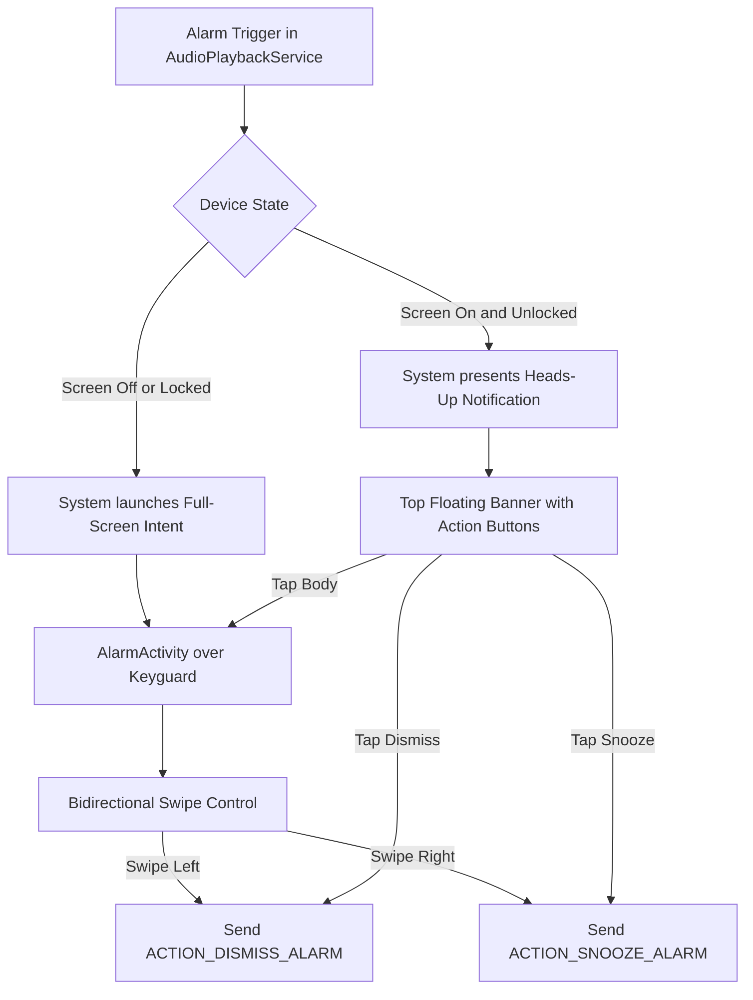

# Incoming-Call-Style Alarm Handling Architecture

This document describes the architectural design and implementation plan for incoming-call-style alarm handling in the "On Time" Android application.

## Overview & Goals

When a scheduled or manual alarm rings, the app must present a responsive, non-intrusive, and accessible interaction model matching standard Android telephony and clock applications:
1. **Lock Screen / Screen Off**: Launch an overlay Activity directly over the lock screen featuring a bidirectional swipe control (**Swipe Right = Snooze**, **Swipe Left = Dismiss**).
2. **Device Unlocked / In Another App**: Display a high-priority floating Heads-Up Notification (HUN) at the top of the screen with quick-action buttons for **Snooze** and **Dismiss**, without forcibly hijacking the active foreground app.



---

## Android Platform Mechanics

Android provides native dual-routing for high-priority alarms via `NotificationCompat.Builder.setFullScreenIntent(PendingIntent, Boolean)`:

- **When the device is interactive and unlocked**: The Android NotificationManager suppresses full-screen Activity launching and instead displays a Heads-Up Notification (HUN) banner with attached action buttons at the top of the viewport.
- **When the device is non-interactive (screen off) or keyguard is locked**: The system executes the full-screen intent immediately, inflating the specified Activity over the lock screen without requiring user authentication.

### Permissions & Manifest Requirements

1. **Permissions** in `AndroidManifest.xml`:
   - `android.permission.USE_FULL_SCREEN_INTENT` (mandatory for Android 10+ / API 29+, with special platform policy enforcement in Android 14+ / API 34+).
   - `android.permission.WAKE_LOCK` (to ensure the CPU remains active while ringing).
   - `android.permission.POST_NOTIFICATIONS` (for Android 13+ / API 33+ notification delivery).
   - `android.permission.USE_EXACT_ALARM` / `SCHEDULE_EXACT_ALARM` (for precision scheduling).

2. **Activity Declaration** in `AndroidManifest.xml`:
   - Attributes:
     - `android:showWhenLocked="true"`
     - `android:turnScreenOn="true"`
     - `android:excludeFromRecents="true"`
     - `android:launchMode="singleInstance"` or `singleTask`
     - `android:exported="false"`

---

## Detailed Component Specifications

### 1. AlarmActivity (`app/src/main/java/com/kappacs/ontime/audio/AlarmActivity.kt`)

The dedicated full-screen overlay Activity launched over the lock screen.

- **Window & Keyguard Configuration**:
  - For API 27+ (Android O MR1+): Invoke `setShowWhenLocked(true)` and `setTurnScreenOn(true)` in `onCreate`.
  - Add window flag `FLAG_KEEP_SCREEN_ON` to prevent display sleep while an alarm is actively ringing.
- **Lifecycle & Synchronization**:
  - Binds to `AudioPlaybackService` or observes `AudioPlaybackService.state`.
  - If `isAlarmRinging` becomes `false` (e.g., dismissed from notification or another source), `AlarmActivity` finishes immediately.
  - Intercepts back button and home gestures to prevent accidental dismissal without an explicit snooze or dismiss action.

### 2. Lock Screen Swipe Control (`SwipeActionView` / `MotionLayout`)

A custom touch-handling view or `MotionLayout` implementing an incoming-call-style bidirectional slider:

- **Center Slider Thumb**: Neutral center position with visual indicators (e.g. left chevron for Dismiss, right chevron for Snooze).
- **Threshold Detection**:
  - Dragging > 40% width to the left triggers **Dismiss** with a red accent and optional tactile haptic feedback (if enabled in settings).
  - Dragging > 40% width to the right triggers **Snooze** with a blue/amber accent and optional tactile haptic feedback (if enabled in settings).
  - Releasing before the threshold snaps the slider back to center via spring animation.
- **Haptic Feedback Configuration**:
  - Haptic feedback is configurable in settings via `KEY_HAPTIC_FEEDBACK_ENABLED` (boolean) and is **disabled by default (`false`)**.
  - When enabled, `performHapticFeedback(HapticFeedbackConstants.CONFIRM)` is invoked when crossing action thresholds.
- **Accessibility**: Provide secondary accessible click targets or accessibility action announcements for TalkBack users.

### 3. Notification Architecture in `AudioPlaybackService.kt`

Split notification channels to separate normal background audio from ringing alarms:

1. **Background Sound Channel (`bg_playback_channel`)**:
   - Importance: `NotificationManager.IMPORTANCE_LOW`
   - Purpose: Ongoing media playback notifications that do not trigger popups.
2. **Alarm Channel (`alarm_ringing_channel`)**:
   - Importance: `NotificationManager.IMPORTANCE_HIGH` (or `IMPORTANCE_MAX`)
   - Sound: Set to `null` on the channel (since `AudioPlaybackService` manages audio stream playback directly via MediaPlayer/ExoPlayer).
   - `setBypassDnd(true)` (where supported) and `setLockscreenVisibility(Notification.VISIBILITY_PUBLIC)`.

3. **Notification Building**:
   ```kotlin
   val fullScreenIntent = Intent(this, AlarmActivity::class.java).apply {
       flags = Intent.FLAG_ACTIVITY_NEW_TASK or Intent.FLAG_ACTIVITY_CLEAR_TOP
   }
   val fullScreenPendingIntent = PendingIntent.getActivity(
       this,
       ALARM_FULLSCREEN_REQ_CODE,
       fullScreenIntent,
       PendingIntent.FLAG_UPDATE_CURRENT or PendingIntent.FLAG_IMMUTABLE
   )

   val notification = NotificationCompat.Builder(this, ALARM_CHANNEL_ID)
       .setSmallIcon(R.drawable.ic_alarm)
       .setContentTitle(getString(R.string.alarm_status_ringing))
       .setContentText(getString(R.string.alarm_active_desc))
       .setPriority(NotificationCompat.PRIORITY_MAX)
       .setCategory(NotificationCompat.CATEGORY_ALARM)
       .setFullScreenIntent(fullScreenPendingIntent, true)
       .setOngoing(true)
       .addAction(R.drawable.ic_close, getString(R.string.alarm_dismiss), dismissPendingIntent)
       .addAction(R.drawable.ic_snooze, getString(R.string.alarm_snooze), snoozePendingIntent)
       .build()
   ```

---

## State & Transition Edge Cases

1. **Device Unlocked During Ringing**:
   If the user unlocks their phone while `AlarmActivity` is showing, the Activity remains visible or transitions gracefully without killing audio playback.
2. **External Dismissal**:
   If the user dismisses via the floating Heads-Up Notification while `AlarmActivity` is in the foreground, the service stops audio and broadcasts or updates StateFlow, causing `AlarmActivity` to immediately call `finishAndRemoveTask()`.
3. **Reboot While Alarm Ringing**:
   The existing `BootAndUpgradeReceiver` restores pending alarm state, restarting `AudioPlaybackService` with `ACTION_START_ALARM`, which re-triggers the notification and full-screen intent.
4. **Volume Rocker / Power Key**:
   Hardware buttons (Volume Up/Down, Power) are **explicitly not used** as alternate snooze or dismiss inputs. Because physical buttons are prone to accidental presses, pocket triggers, or pressing the wrong key when groggy, alarm actions are strictly limited to intentional on-screen gestures (bidirectional swipe) and notification actions. Volume keys retain standard system volume behavior and `AlarmActivity` does not intercept them for alarm state transitions.

---

## Step-by-Step Implementation Plan

### Phase 1: Permissions & Notification Channel Configuration
- [ ] Add `android.permission.USE_FULL_SCREEN_INTENT` to `app/src/main/AndroidManifest.xml`.
- [ ] Update `AudioPlaybackService.createNotificationChannel()` to create two distinct channels: `CHANNEL_ALARM_HIGH` (Importance: High) and `CHANNEL_BG_LOW` (Importance: Low).
- [ ] Update `AudioPlaybackService.buildNotification()` to use `CHANNEL_ALARM_HIGH`, `CATEGORY_ALARM`, and `PRIORITY_MAX` with `setFullScreenIntent` when `isAlarmRinging == true`.

### Phase 2: Full-Screen Alarm Activity & Layout
- [ ] Create layout `app/src/main/res/layout/activity_alarm.xml` displaying event title, current time, and swipe target containers.
- [ ] Declare `AlarmActivity` in `app/src/main/AndroidManifest.xml` with `showWhenLocked`, `turnScreenOn`, and full-screen theme.
- [ ] Implement `AlarmActivity.kt` handling lock screen window flags (`setShowWhenLocked(true)`, `setTurnScreenOn(true)`, `FLAG_KEEP_SCREEN_ON`).
- [ ] Bind `AlarmActivity` to `AudioPlaybackService.state` to finish when alarm ceases ringing.

### Phase 3: Lock Screen Swipe Control Widget
- [ ] Add haptic feedback toggle setting:
  - Add `KEY_HAPTIC_FEEDBACK_ENABLED` in `SettingsRepository` (default: `false`).
  - Add "Haptic Feedback" switch / toggle in `activity_settings.xml` and wire in `SettingsActivity.kt`.
- [ ] Implement bidirectional swipe view (`SwipeActionView.kt` or `MotionLayout` controller):
  - Left swipe threshold = Trigger `ACTION_DISMISS_ALARM`
  - Right swipe threshold = Trigger `ACTION_SNOOZE_ALARM`
  - Smooth release rebound animation and tactile haptic feedback (conditioned on user setting).
  - Explicitly exclude Volume/Power button key intercepts for snooze/dismiss.
- [ ] Add accessibility support with clear content descriptions and fallback touch buttons for accessibility services.

### Phase 4: Verification & Validation
- [ ] Test screen-off / locked state: Trigger scheduled alarm via adb/time and verify `AlarmActivity` wakes screen and shows swipe controls.
- [ ] Test unlocked state: Trigger alarm while using another app and verify Heads-Up Notification appears with working Snooze/Dismiss buttons.
- [ ] Test snooze and dismiss action parity between notification buttons and swipe gesture.
