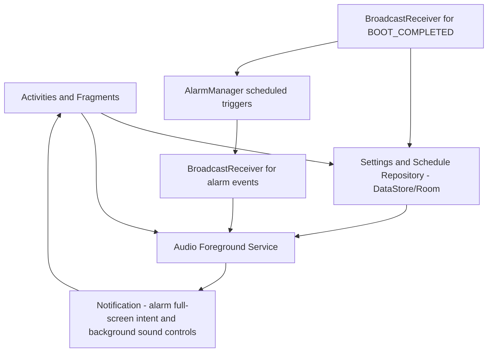

# On Time — Architecture

This document describes the technical design of the "On Time" Android app. See
[`requirements.md`](requirements.md) for the source requirements and
[`decisions.md`](decisions.md) for the rationale behind specific choices.

## Component Overview



- **Audio Foreground Service** (`app/src/main/java/com/kappacs/ontime/audio/`) owns all
  playback (background sound + alarm tone) so it survives screen lock and Activity
  destruction. This is the only component allowed to touch `MediaPlayer`/`ExoPlayer`.
- **Repository** persists settings, the schedule list, and "pending state" (is background sound playing, is an alarm ringing, is an alarm snoozed, and snooze trigger time) so it can be restored after reboot/app update.
- **AlarmManager + BroadcastReceiver** fire scheduled stop/start events even when the app
  isn't running; the receiver only forwards intents to the Service — it must not do
  playback work itself (receivers have a very short execution window).
- **Boot receiver** re-reads persisted state on device restart / app upgrade, re-arms alarms, resumes background sound if it was active, resumes active (ringing) alarms, and reschedules snoozed alarms.

## Module / Package Layout (planned)

```
app/src/main/java/com/kappacs/ontime/
├── MainActivity.kt              # Phase 2+: main screen (play/stop background, alarm status)
├── audio/
│   ├── AudioPlaybackService.kt  # Foreground Service (Phase 3)
│   └── FadeController.kt        # Fade-in/out + transition math (Phase 5-7)
├── settings/
│   ├── SettingsActivity.kt      # Phase 4
│   └── SettingsRepository.kt    # DataStore-backed (Phase 4)
├── schedule/
│   ├── ScheduleEditorActivity.kt # Phase 8
│   ├── ScheduleEvent.kt          # data model incl. Enabled flag (Phase 8)
│   ├── ScheduleRepository.kt     # persistence (Phase 9)
│   └── ScheduleEngine.kt         # AlarmManager arming/re-arming (Phase 9)
└── boot/
    └── BootAndUpgradeReceiver.kt # Phase 10
```

## Key Architectural Constraints

- Alarm/background controls must remain visually and logically distinct in the UI
  (explicit requirement) — do not merge them into a single button/state.
- Schedule events are enable/disable-able without deletion (the `Enabled` flag). The
  scheduling engine must filter on this flag rather than removing/recreating
  `AlarmManager` entries when toggled off.
- Any number of schedule events must be supported — do not assume a fixed max when
  designing storage or the AlarmManager request-code scheme (each event needs a stable
  unique PendingIntent request code, e.g. derived from its persisted row ID).
- Fade transitions: alarm-during-background must fade background to silent over `t`
  seconds, THEN fade in the alarm over the next `t` seconds (sequential, not
  simultaneous) — total 2t seconds.

## Toolchain (no Android Studio GUI)

This project is built and run entirely via Gradle CLI + adb, without requiring the
Android Studio IDE. See [`decisions.md`](decisions.md) for why, and
[`../scripts/setup-dev-env.sh`](../scripts/setup-dev-env.sh) /
[`../scripts/setup-dev-env.ps1`](../scripts/setup-dev-env.ps1) for the bootstrap
scripts that install JDK 17 + Android SDK cmdline-tools into a local, gitignored
`.tools/` directory on any machine (Linux/macOS/Windows).
